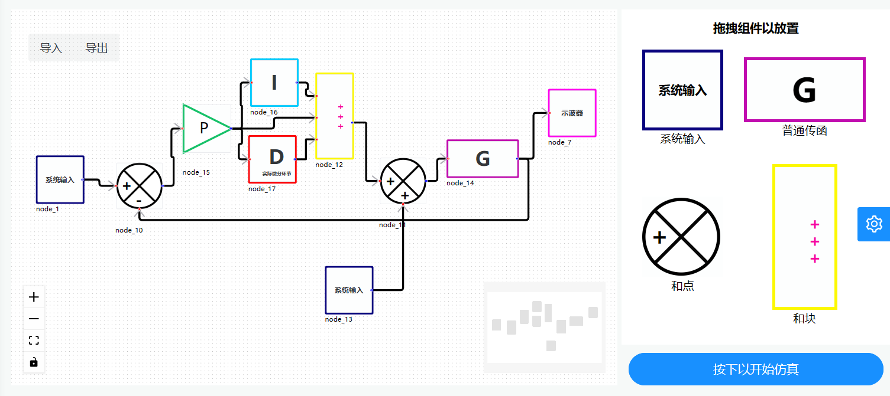
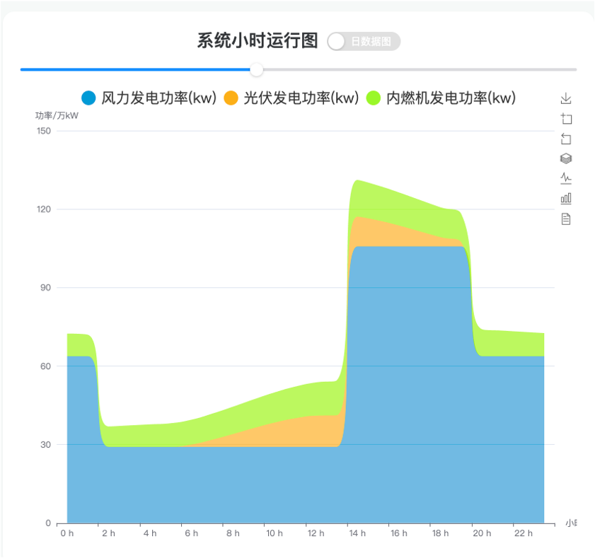
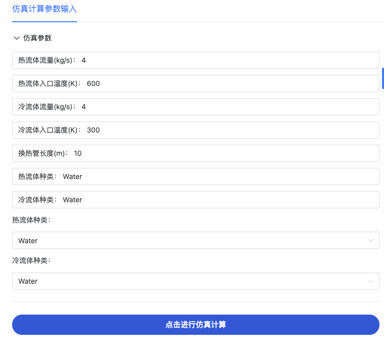
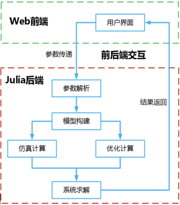

# IES-DOPT — 综合能源系统仿真与设计优化 Web 平台

**Open-source Full-stack Integrated Energy System Simulation & Optimization Platform**

IES-DOPT 是基于 **Vue 3 + TypeScript + Julia** 的开源综合能源系统仿真与设计优化 Web 平台，包含 Web 前端与 Julia 计算后端源码。现有应用覆盖工程静态仿真、Jumulink 图形化动态控制系统仿真，以及**离网风光制氢系统**的容量优化、经济性分析和结果可视化。

IES-DOPT is an open-source full-stack web platform for integrated energy system simulation and design optimization, with a Vue 3 frontend and a Julia scientific-computing backend. Its documented optimization case is an off-grid wind/solar-to-hydrogen system.

[中文](README.md) · [English](README_EN.md) · [项目文档](https://ccchhhddd.github.io/IES-DOPT/) · [Releases](https://github.com/ccchhhddd/IES-DOPT/releases) · [FAQ](docs/PROJECT_FAQ.md) · [制氢案例](docs/USE_CASES.md)

## 核心功能与证据

| 功能 | 当前范围与可核验证据 |
| --- | --- |
| 工程静态仿真 | 朗肯、再热与制冷循环，顺逆流换热器，文丘里管压力分布，PID 控制实验；见[静态仿真文档](docs/src/index.md)与 [Julia 模型](backend/src/Simulation) |
| 图形化动态仿真 | Jumulink 支持拖拽控制系统方框图、传递函数与响应曲线；见[操作说明](docs/src/Dynamic_simulation/Jumulink.md)、[前端](src/views/controler/scenario)和[后端](backend/src/Jumulink) |
| 能源系统设计优化 | 当前公开案例为离网制氢，支持设备容量选择、三类优化目标和黑箱寻优方法选择；见[案例文档](docs/src/Optimization/离网制氢.md)与[优化源码](backend/src/Optimization/optimize.jl) |
| 可视化与表格输出 | 风光环境、系统小时运行、制氢曲线及规模与经济性表的 Excel 导出；[HTTP 接口](backend/src/backend.jl)提供 8760 小时坐标，导出实现见[前端页面](src/views/optimization/workbench/components/mode-choice/index.vue) |

## 系统界面

以下图片均来自仓库现有文档，展示历史版本界面，不代表本次重新运行得到的计算结果。



Jumulink：组合传递函数、比例、积分、微分与输入输出模块，进行动态控制系统仿真。



离网制氢：按小时查看风电、光伏及补充发电功率；详细输入、输出和模型限制见[制氢案例](docs/USE_CASES.md)。



静态仿真：设置流体、温度、流量及换热管长度，查看换热计算结果。

## 技术架构

```text
Vue 3 / TypeScript Web 前端 (src/)
               ↕ HTTP / JSON
Julia / Oxygen 计算后端 (backend/)
  ├─ 工程静态仿真与 PID 控制实验
  ├─ Jumulink 线性控制系统仿真
  └─ 离网制氢仿真与容量优化
```

- **前端：** Vue 3、TypeScript、Vite、Naive UI、ECharts、Vue Flow；界面基于 Soybean Admin 模板。
- **后端：** Julia、Oxygen/HTTP、ModelingToolkit、DifferentialEquations、CoolProp、BlackBoxOptim 等现有计算模块。
- **接口：** [后端路由](backend/src/backend.jl)连接参数输入、模型计算、曲线和表格输出。前后端源码均在本仓库，可用于学习 Web 与科学计算的集成方式。

## 项目状态与功能边界

| 状态 | 说明 |
| --- | --- |
| 已实现 | 上述工程算例、Jumulink 控制系统方框图、离网制氢仿真与容量寻优已有源码、文档及历史 Release 依据；此标记不表示本次已完成运行复现 |
| 部分实现或实验 | 离网制氢是研究原型，采用简化运行逻辑和经济假设；黑箱寻优结果不保证全局最优。8760 小时接口坐标与所选运行天数、输入数据长度仍需运行核对 |
| 规划中 | 扩展优化场景、完善设备与运行逻辑等见 [v.2.1 后续计划](https://github.com/ccchhhddd/IES-DOPT/releases/tag/v.2.1)，不能当作当前能力 |

项目面向教学研究与设计阶段分析。Jumulink 的拖拽范围是控制系统方框图，尚无证据表明支持任意综合能源拓扑自动求解；现场设备接入、生产级实时 EMS/SCADA 与多租户服务也不属于已验证能力。离网案例包含天然气补充发电，不能据此保证全流程零碳制氢。

截至 2026-10-25，最近公开 Release 为 **v.2.1（2024-03-16）**。本项目的功能发布记录以 [IES-DOPT Releases](https://github.com/ccchhhddd/IES-DOPT/releases) 为准；根目录 `CHANGELOG.md` 保留了 Soybean Admin 模板历史。

## 开始使用与文档

- [本地开发与启动步骤](#使用说明本地开发者模式)：先核对运行环境及已知限制；当前不承诺一键启动。
- [服务器部署原有流程](#部署服务器)：保留历史 Docker 示例，使用前核对路径、镜像名、端口及服务地址。
- [功能文档入口](docs/src/index.md) · [在线项目文档](https://ccchhhddd.github.io/IES-DOPT/)（文档站）
- [FAQ：前后端、拖拽范围与运行条件](docs/PROJECT_FAQ.md) · [离网制氢输入、目标与输出](docs/USE_CASES.md)

## 许可证与来源

仓库包含 [MIT 许可证](LICENSE)，现有版权行是 `Copyright (c) 2021 Soybean`。前端使用 [Soybean Admin](https://github.com/honghuangdc/soybean-admin) 等开源技术；请保留相关版权与来源，第三方模块的使用条件以各自许可证为准。[项目过程](#项目过程)保留项目起源与 Ai4Energy 支持说明。

## 项目结构

```shell
.
├── .github
	└── workflows # github actions 自动化部署配置文件
		└── Documentation.yml # 文档部署配置文件
├── .vscode # vscode配置文件，本地化配置文件，一般不上传
	└── settings.json
├── docker # Docker文件
	├── Dockerfile # Docker配置文件
	└── nginx.conf # ngnix服务配置文件
├── docs # 项目文档内容
	├── Project.toml # 文档环境配置文件
	├── make.jl # 文档生成配置文件
	└── src # 文档内容
		├── index.md # 介绍文档API
		└── assets 静态资源(如图片)存放文件夹
├── backend #后端代码
	├── src # 项目源码
		├── Controler # 静态仿真PID控制仿真实验
		├── Jumulink  # 动态仿真源码
		├── Optimization # 设计优化源码
			├── data # 数据文件夹
			├── function_Electricity.jl #发电设备
			├── function_Financial.jl #经济计算
			├── function_Gas.jl #产氢气、用气函数
			├── function.jl #补充功能函数
			├── optimize.jl #优化功能重载总文件
			├── optimize_test.jl #优化板块测试文件
			├── simulate.jl #仿真功能重载总文件
			├── simulate_test.jl #仿真板块测试文件
			└── structs.jl # 能源系统组件
		├── Simulation # 静态仿真源码
			├── HeatExchanger.jl #顺逆流换热器仿真
			├── Thermodynamics.jl #热力循环仿真
			└── VenturiMeter.jl # 文丘里管压力分布仿真
		├── backend.jl # 后端服务总文件
		├── function.jl # 补充功能函数
		├── head.jl # 头文件
		└── test.jl # 测试文件
	├── Dockerfile # 后端镜像本地打包
	├── .dockerignore # docker后端镜像本地打包忽略文件
	└── main.jl # 项目后端启动入口文件，启动服务
├── mock # 前端登录验证文件
├── public  # 全局静态资源
├── .gitignore # git提交忽略文件
├── src # 前端源文件
├── package.json # 前端核心配置文件
├── README.md # 项目说明文件
├── Manifest.toml # 依赖配置文件，Julia自动生成，无需手动修改
└── Project.toml # 库环境配置文件
```

## 项目前端技术

### Vue3 框架


本项目前端采用 [Vue 3](https://vuejs.org/) 构建参数输入、交互与结果展示界面，使用 TypeScript 组织前端代码。

### Soybean Admin 模版


项目前端基于 [Soybean Admin](https://github.com/honghuangdc/soybean-admin) 中后台模板，结合 Naive UI、Pinia、UnoCSS 等库构建界面。上游模板的来源与版权信息应予保留。

## 项目后端技术

### Julia 语言


[Julia](https://julialang.org/) 是面向科学与数值计算的开源编程语言。本项目使用 Julia 实现仿真模型、微分方程求解及设计优化；具体性能取决于模型、算法和运行环境，此处不作跨语言速度保证。

## 前后端交互

前端通过 HTTP 请求发送参数到 Julia 后端，后端计算后返回曲线与表格数据，前端负责可视化。接口定义见 [backend/src/backend.jl](backend/src/backend.jl)。



## 部署服务器

以下为项目原有服务器部署流程，镜像账号与命名示例保留供参考。本轮未执行镜像构建或部署；使用前需核对构建目录、端口映射与服务地址。

### 前端部署

1.对项目文件进行本地打包生成 dist 文件夹

```
npm run build
```

2.执行命令运行 Dockerfile 文件，对采用 ngnix 服务的前端项目进行 docker 镜像封装

```
docker build -t front_end -f .\docker\Dockerfile .
```

3.对生成的 docker 镜像进行改名操作(dockerhub 用户名/镜像名)

```
docker tag front_end chenghd/front_end
```

4.将镜像 push 到远端 dockerhub 仓库

```
docker push chenghd/front_end
```

5.在服务器端拉取远端镜像

```
docker pull chenghd/front_end
```

6.在服务器端运行 docker 镜像生成 docker 容器

```
docker run --name front -p 80:80 -d chenghd/front_end
```

### 后端部署

1.在本地打包镜像

```
docker build -t backend .
```

2.将后端的本地镜像压缩成 linux 系统可识别的压缩包 .tar

```
docker save  [image] -o image.tar
```

3.将镜像压缩包 tar 上传至服务器（这里可以使用 mobaxterm 终端工具）

https://mobaxterm.mobatek.net/

4.在服务器端对压缩包进行解压

```
docker load -i image.tar
```

5.查看镜像

```
docker images
```

6.运行后端镜像

```
docker run --name [容器名] -p 8080:80 -d [镜像名]
```

## 使用说明(本地开发者模式)

以下命令根据当前文件路径和脚本整理，本轮未安装依赖或启动服务。前端版本见 `package.json`；根目录 `Manifest.toml` 记录 Julia 1.11.2，而 `backend/Dockerfile` 使用 Julia 1.9.2，兼容范围尚需复现确认。Julia 环境文件位于仓库根目录，启动后端时工作目录需为 `backend/`。

已知运行限制：部分天气数据引用与实际文件名大小写不同，区分大小写的文件系统可能无法读取；前端服务地址与跨域访问也需结合实际环境核对。本次仅更新文档，相关代码与配置保持现状。

### 先将项目克隆到本地

#### 方法一：使用 GitKraken 进行项目克隆及项目相关操作（推荐）

GitKraken 使用详情请见 https://ai4energy.github.io/Ai4EDocs/dev/WorkFlow/gitworkflow/

如果你是学生可以使用学校的邮箱注册，学生包有 gitkraken 的会员 https://education.github.com/pack

#### 方法二：git 命令行手动操作

首先创建一个空的文件夹用于存放项目，在创建的文件夹中 右键选择 Git Bash Here
输入

```
git init
```

```
git clone https://github.com/ccchhhddd/IES-DOPT.git
```

如果克隆过程存在问题，请参考 [GitHub 官方克隆文档](https://docs.github.com/en/repositories/creating-and-managing-repositories/cloning-a-repository)。

### 前端

前端需要下载 node.js 使用 npm 库安装相关库以及运行相关代码

```
npm install
```

```
npm run dev
```

### 后端

在仓库根目录初始化现有 Julia 项目环境：

```shell
julia --project=. -e 'using Pkg; Pkg.instantiate()'
```

然后进入 `backend/` 启动现有入口 [backend/main.jl](backend/main.jl)，继续使用根目录环境：

```shell
cd backend
julia --project=.. main.jl
```

入口会加载 `backend/src/backend.jl`，当前源码监听端口为 8080。若报告缺包，请先核对根目录环境和现有依赖声明；不要将旧说明中的 `backend/src/main.jl` 当作启动入口，该文件不存在。

初次进行运算时间会略长，请耐心等待

### 文档

本地编译 markdown 文件到 html 请使用如下命令：

```shell
julia --project=docs/ -e 'using Pkg; Pkg.update(); Pkg.instantiate()'
julia --project=docs/ docs/make.jl
```

`docs/src/` 中包含文档正文、相关代码说明与图片资源。

## 项目过程

本项目起源于西安交通大学 2023 年大创项目，同时也在[Ai4Energy](https://github.com/ai4energy)开源组织的大力支持下才有了这样的成果。

### 项目第一期时间段: 2023.3——2024.5

在该时间段中共完成了平台版本从 v.1.0 到 v.2.1 的[版本迭代](https://github.com/ccchhhddd/IES-DOPT/releases)。

#### 技术管理

采用[git](https://git-scm.com/)版本控制工具，以及[Gitkraken](https://www.gitkraken.com/)版本控制图形化神器

#### 团队管理

利用[飞书](https://www.feishu.cn/)软件进行团队管理，例如建立甘特图、时间进度表、思维导图等
