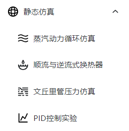

# IES-DOPT 综合能源系统仿真优化平台

## 简介

IES-DOPT 是开源综合能源系统仿真与设计优化 Web 平台，包含 Vue 3 / TypeScript 前端和 Julia 计算后端，通过 HTTP API 交互。已实现的工程算例涵盖热力循环、换热器、文丘里管及 PID；Jumulink 提供线性控制系统方框图建模；当前优化案例为离网风光制氢。平台面向教学研究和设计分析，制氢模块仍是采用简化假设的研究原型，任意能源拓扑求解和生产级实时 EMS 不属于已验证能力。

IES-DOPT is an open-source full-stack integrated energy system simulation and design optimization platform built with Vue 3 and Julia.

**功能导航：** [热力循环](Static_simulation/蒸汽动力循环仿真.md) · [换热器](Static_simulation/顺流与逆流式换热器仿真.md) · [文丘里管](Static_simulation/文丘里管压力仿真.md) · [PID](Static_simulation/PID控制仿真实验.md) · [Jumulink](Dynamic_simulation/Jumulink.md) · [离网制氢](Optimization/离网制氢.md)

[源码与 README](https://github.com/ccchhhddd/IES-DOPT)包含中英文入口、FAQ、案例与启动说明。[IES-DOPT Releases](https://github.com/ccchhhddd/IES-DOPT/releases)记录项目功能版本；根目录 CHANGELOG 保留的是上游模板历史。已有功能表示存在源码及历史文档依据，不表示已完成任意环境下的部署复现。扩展优化场景与完善运行逻辑仍属 v.2.1 所列后续计划。

## IES-DOPT 和其他能源开源项目的区别

- **IES-DOPT：** Vue Web 前端与 Julia 后端组成的应用，提供具体工程仿真、控制系统与离网制氢设计案例。
- **[PyPSA](https://docs.pypsa.org/latest/) / [IESopt.jl](https://github.com/ait-energy/IESopt.jl)：** 侧重能源系统建模与优化框架；IESopt.jl 是独立项目。
- **[OpenEMS](https://openems.io/)：** 侧重能源设备监测与控制。IES-DOPT 当前没有同等现场控制覆盖度的验证依据；此处仅区分用途，不作性能或成熟度排名。

## 平台三大功能

### 1.静态仿真

#### 平台导航栏

#### 简介

**该板块共包括四个场景的仿真，即从热力学、流体力学、传热学、自动控制原理中分别选取了一个经典模型进行仿真求解——蒸汽动力循环仿真、文丘里管压力分布、顺流与逆流式换热器温度分布仿真、基于无自平衡能力系统的 PID 控制仿真。**

**蒸汽动力循环仿真**支持三个循环（包括朗肯循环、再热循环以及制冷循环）模式的仿真。通过用户输入的参数（如冷凝器冷却压力、锅炉出口温度等），计算出整个循环过程中温度、压力、焓、熵等参数。同时，该部分使用单独描述系统中每个组件并连接在一起的组件化建模方法，极大地提高了建模的效率。用户可以据此比较不同循环参数和组件配置对性能的影响，优化循环设计，并找到达到最佳性能的操作条件。

**文丘里管压力分布仿真**利用了伯努利原理对不同参数（如流量、有无摩擦、介质种类等参数）下文丘里管压力分布进行仿真模拟。通过用户输入的不同参数，可以模拟在该参数约束下文丘里管的状态，从而使用户更直观地了解其压力分布情况。

**换热器温度分布仿真**模拟了一个套管式换热器的换热情况，在操作界面可以调整换热器的长度，介质种类，顺逆流，冷、热流入口温度、流量，通过计算会获得换热器不同部位的温度值，整体换热速率等信息，更直观的了解到换热器的换热情况。此仿真过程将换热原理与 ODE 结合，使模型更精准。

**PID 控制仿真**通过调节和优化参数，对不同参数组合的仿真结果进行比较，评估 PID（比例-积分-微分）控制器在系统中的性能表现，包括稳态误差、响应时间、抗干扰能力等指标，以找到最佳的 PID 控制器参数，实现更好的控制效果，提高系统的控制精度和稳定性。

静态仿真板尝试了不同领域知识与软件仿真技术的结合，为后续的动态仿真、综合能源系统仿真优化打下坚实基础。

#### 文档索引

##### [蒸汽动力循环仿真](Static_simulation/蒸汽动力循环仿真.md)

##### [顺流与逆流式换热器仿真](Static_simulation/顺流与逆流式换热器仿真.md)

##### [文丘里管压力仿真](Static_simulation/文丘里管压力仿真.md)

##### [PID 控制仿真实验](Static_simulation/PID控制仿真实验.md)

### 2.动态仿真

#### 平台导航栏

#### 文档索引

##### [Jumulink](Dynamic_simulation/Jumulink.md)

#### 简介

Jumulink 提供以传递函数描述的线性控制系统的图形化建模、求解与响应可视化。用户可以拖拽并连接输入、传递函数、比例、积分、微分等模块；具体支持范围见 Jumulink 操作文档。这里的控制系统方框图功能不能直接扩展表述为任意综合能源系统拓扑求解或通用图像处理平台。

### 3.优化

#### 平台导航栏

#### 文档索引

##### [离网制氢](Optimization/离网制氢.md)

#### 简介

当前公开优化场景为离网风光制氢。用户选择地区风光资源、设备型号与数量、运行期和经济参数后，可进行仿真，并对所选设备容量开展黑箱寻优；支持单位氢气成本最低、投资约束下产氢量最大、最低制氢量约束下投资最低三类目标。页面展示风光环境、小时运行、制氢曲线和规模经济性表，并提供表格导出。

该模块是采用简化运行与经济假设的研究原型，含天然气补充发电，当前不考虑燃料电池参与；不能保证全流程零碳或寻优结果全局最优。HTTP 接口使用 8760 小时坐标，所选运行期和数据长度仍需实际核对。详细输入输出、系统结构与历史截图见离网制氢文档，截图中的结果不构成普遍收益承诺。
